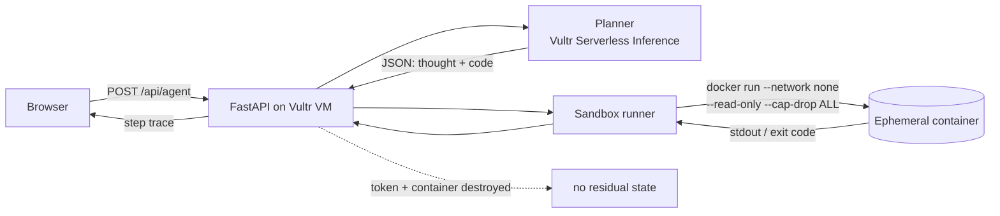

# Blast Radius Zero

An agent that does real work and provably cannot hurt the host. Every task it
plans is executed in a throwaway container: no network, 512 MB, 1 CPU, 128 PIDs,
read-only root filesystem, 15 second wall clock, destroyed afterwards.

Built for the **Vultr Agent Rush** hackathon (track: *Blast Radius Zero*), and
reused as the red-team fixture for **Lexsi AI Safety & Alignment** and the
retrieval demo for **Geek Room Global AI**.

## Architecture



Three boundaries, and only three:

1. **Process** — user code never enters the app process. The host only shells
   out to `docker run` and reads pipes.
2. **Network** — `--network none`. No egress, no SSRF, no exfiltration.
3. **Lifecycle** — `--rm` plus a name-scoped `docker kill` on timeout. Nothing
   survives a task.

## Quickstart

```bash
cp .env.example .env          # add VULTR_INFERENCE_API_KEY
docker compose up --build     # http://localhost:8000
```

Without Docker Desktop, run the API directly if the host has Docker:

```bash
python -m venv .venv && . .venv/bin/activate
pip install -r requirements.txt
uvicorn app.main:app --reload
```

## Prove containment

```bash
python tests/test_containment.py
```

Measured on this machine (Docker Desktop 29.7.2, `python:3.12-slim`, 2026-11-04):

```
PASS host_survives_rm_rf 840 ms
PASS timeout_kills_infinite_loop 3.2s
PASS network_is_blocked
PASS secrets_do_not_leak_in

all containment checks passed
```

The first test writes a sentinel file on the host, then runs `rmtree('/')` and
`os.remove('/etc/passwd')` inside the sandbox. The sentinel survives, the
read-only root blocks the deletion, and the container reports `still alive`
right before it is destroyed.

## API

| Endpoint | Body | Returns |
|---|---|---|
| `GET /healthz` | — | image, model |
| `POST /api/run` | `{"code": "...", "timeout": 15}` | stdout, stderr, exit code, duration |
| `POST /api/agent` | `{"task": "...", "max_steps": 4}` | step trace + final answer |

### Recorded runs (`POST /api/run`, uvicorn on 127.0.0.1:8000)

| Payload | Result |
|---|---|
| `GET /healthz` | `{"ok":true,"image":"python:3.12-slim","model":""}` |
| `rm -rf /` equivalent (`shutil.rmtree('/')` + `os.remove('/etc/passwd')`) | `BLOCKED /etc/passwd OSError [Errno 30] Read-only file system`, `BLOCKED /usr ...`, `BLOCKED / ...`, `still alive`, exit 0, 375 ms |
| `while True: pass` | `timed_out: true`, `exit_code: null`, 3158 ms, container killed |
| `socket.create_connection(('1.1.1.1', 53))` | `NETWORK BLOCKED OSError`, 392 ms |
| `docker ps --format '{{.Names}}'` right after | empty |

## Vultr integration (what runs where)

| Piece | Vultr service | Status |
|---|---|---|
| Planner LLM (`app/llm.py`) | Serverless Inference, `https://api.vultrinference.com/v1`, OpenAI-compatible | code ready; needs an API key with credits |
| Orchestrator + demo UI (`app/main.py`, `web/index.html`) | Cloud Compute VM, Docker Compose | not deployed yet (no Vultr account) |
| Per-task execution | sibling Docker containers on the same VM (`--network none`, read-only root, caps) | running locally, proven by the tests above |

No GPU is used or needed: the LLM is remote inference, the sandbox is CPU-only.

Deploy steps (once an account exists):

```bash
# on a fresh Ubuntu 24.04 VM, 2 vCPU / 4 GB
sudo apt update && sudo apt install -y docker.io docker-compose-v2 git
git clone https://github.com/<you>/<repo>.git && cd <repo>
cp .env.example .env      # VULTR_INFERENCE_API_KEY=...
docker compose up -d --build
curl -s localhost:8000/healthz
python3 tests/test_containment.py     # expect 4/4 PASS on the VM too
```

Then terminate nothing, add Caddy/nginx for TLS, and point the public demo URL at
port 8000.

## Demo script (90 seconds)

1. Ask the agent a CSV question. It plans, runs, plots, answers.
2. Open the step trace — show the generated code and the container's stdout.
3. **Containment moment:** submit `shutil.rmtree('/')`. The step fails inside
   the box, the trace shows the error, the host keeps serving.
4. Submit `while True: pass`. The wall clock kills it at 15 s.
5. Show `docker ps` — nothing left running.

## Roadmap

- [ ] Sandboxed browser track (`Playwright` in the same container profile)
- [ ] Per-task Vultr instance via the Vultr API instead of sibling containers
- [ ] Red-team suite: prompt injection, tool-argument smuggling, resource bombs
- [ ] Tavily retrieval step for the Geek Room track
- [ ] StepFun `StepAudio 3` voice layer for the demo
